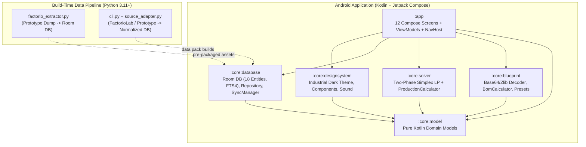

<div align="center">


# Factoria

**Offline-first Android companion app for Factorio 2.0 & Space Age**


*Production ratio linear programming solver, blueprint string inspector, offline codex, Space Age reference tools, and a reproducible Python data pipeline.*

</div>

---

> **Unofficial Fan Project:** Factoria is an unofficial, fan-made companion application for Factorio 2.0 and the Space Age expansion. It is not affiliated with, endorsed by, or sponsored by Wube Software.

## Purpose & Vision

Designing late-game factories in **Factorio 2.0** and **Space Age** involves cyclic recipes (such as Kovarex enrichment, oil cracking, and scrap recycling), five quality tiers, interplanetary logistics, and perishable Gleba supply chains. **Factoria** brings exact linear-programming production planning, blueprint Bill-of-Materials inspection, logistics/power calculators, and a searchable game codex directly to Android—engineered to run **completely offline** out of the box with zero mandatory accounts or backend services.

---

## Key Features

### Production & Ratio Calculator (`:core:solver`)
- **Two-Phase Simplex LP Solver**: Solves steady-state material flow equations across multi-input/multi-output recipes, cyclic catalyst loops (e.g., Kovarex U-235 startup buffers), and probabilistic outputs.
- **Four Optimization Objectives**: Minimize Machines, Minimize Raw Resources, Minimize Power (W/kW/MW/GW), or Minimize Pollution (/min).
- **Space Age Ready**: Supports Normal, Uncommon, Rare, Epic, and Legendary quality tiers, module bonuses, and rate units (`/s`, `/m`, Yellow/Red/Blue/Turbo belts).
- **Saved Factory Profiles & Export**: Persist production plans locally in Room SQLite and share plain-text production summaries via Android's share sheet.

### Blueprint Inspector & BOM (`:core:blueprint`)
- **Factorio 2.0 Blueprint String Decoder**: Decodes `0eN...` Base64 + zlib-compressed strings with a built-in 50 MB decompression-bomb safeguard.
- **Bill of Materials (BOM) Extraction**: Aggregates entity counts, quality-tiered entities, inserted modules, and tiles, flags unrecognized/modded prototypes, and supports nested blueprint-book flattening.
- **Pre-Made 2.0 Blueprint Library**: Includes verified Factorio 2.0 starter blueprints (Solar 4:1 stamp, 480 MW Quad Nuclear core, 3:2 Green Circuit array, Kovarex loop, Space Platform hub) with 1-tap inspect and clipboard copy.

### Offline Codex, Tech Tree & Reference Guides
- **Full-Text Search (FTS4)**: Sub-frame search across items, fluids, recipes, entities, and technologies using SQLite FTS4 with indexed prefix-scan fallback.
- **Interactive Technology Tree**: Recursive DFS prerequisite traversal that computes cumulative science pack totals from the start of the tree.
- **All In-Game Recipes Catalog**: Category filtering (`smelting`, `crafting`, `chemistry`, `centrifuging`, `metallurgy`, `casting`, `organic`, `recycling`, `Oil`), ingredient/product details, and favorite pinning.
- **Enemies & Threat Bestiary**: 21 curated entries across Nauvis, Vulcanus, and Gleba (Biters, Spitters, Worms, Nests, Demolishers, Pentapods) with HP, evolution thresholds, damage resistances, and tactical counters.
- **Space Age Planets Compendium**: Reference cards for Nauvis, Vulcanus, Gleba, Fulgora, Aquilo, and Space Platforms with solar multipliers, day/night cycles, resources, hazards, and strategies.

### Logistics, Power & Factory Checklist
- **10 Built-In Sub-Calculators**: Belts & Inserters, Steam/Nuclear/Solar Power (including dynamic `N×M` reactor adjacency and planetary solar scaling), Beacons & Modules, Belt Balancers Guide, Thermal Steam Buffer Storage, Factorio 2.0 Fluids Reference, Trains & Signals, Quality Tier Matrix, Space Age Cargo Rockets, and Gleba Spoilage & Freshness.
- **Factory Todo & Outpost Checklist**: Offline Room-persisted task list organized and filterable by planet (`Nauvis`, `Vulcanus`, `Gleba`, `Fulgora`, `Aquilo`, `Space Platform`).
- **Optional Verified Data Pack Sync**: Inspect dataset metadata and check HTTPS manifests with SHA-256 checksum verification, SQLite `PRAGMA integrity_check` / `foreign_key_check`, and automatic backup rollback.

---

## Technology Stack

| Layer | Technology | Version / Notes |
| --- | --- | --- |
| Language | Kotlin | `2.0.20` (JVM 17) |
| UI Framework | Jetpack Compose + Material 3 | Compose BOM `2024.10.01`, Navigation Compose `2.8.3` |
| Android Platform | Android Gradle Plugin / SDK | AGP `8.13.2`, Gradle `8.13`, `minSdk 26`, `compileSdk 35`, `targetSdk 35` |
| Persistence | Room + SQLite FTS4 | Room `2.6.1`, KSP `2.0.20-1.0.25`, WAL mode |
| Concurrency & Serialization | Kotlinx Coroutines & Serialization | Coroutines `1.9.0`, Serialization JSON `1.7.3` |
| Math & Compression | Custom Two-Phase Simplex LP, `java.util.zip.Inflater` | Pure Kotlin JVM modules (`:core:solver`, `:core:blueprint`) |
| Data Pipeline | Python 3.11+ (standard library only) | `sqlite3`, `urllib.request`, `json`, `hashlib`, `unittest` |
| Testing | JUnit 4, Kotlinx Coroutines Test, Python `unittest` | Unit tests for solver, blueprint decoder/BOM, and Python ETL |

---

## Architecture Overview

Factoria follows a modular multi-module Android architecture separating pure Kotlin JVM business logic from Android UI and persistence layers, backed by a standalone build-time Python ETL pipeline.



---

## Project Structure

```text
factoria/
├── .github/workflows/ci.yml        # GitHub Actions CI (Python tests, Gradle test/lint/build)
├── app/                            # Android application module
│   └── src/main/
│       ├── AndroidManifest.xml
│       ├── java/com/factoria/
│       │   ├── FactoriaApplication.kt
│       │   ├── MainActivity.kt
│       │   ├── navigation/Screen.kt
│       │   └── ui/                 # Feature packages (dashboard, calculator, codex, blueprint,
│       │                           #   logistics, techtree, recipes, enemies, planets,
│       │                           #   checklist, datapack, more, paywall)
│       └── res/                    # App icons, logo, themes, strings
├── core/
│   ├── model/                      # Pure JVM Kotlin domain models (@Serializable)
│   ├── solver/                     # Pure JVM Two-Phase Simplex LP & ProductionCalculator + tests
│   ├── blueprint/                  # Pure JVM BlueprintDecoder, BomCalculator, presets + tests
│   ├── database/                   # Room database, DAOs, entities, FTS4, SyncManager, bundled assets
│   └── designsystem/               # Material 3 industrial dark theme, reusable Compose UI, audio
├── gradle/
│   ├── libs.versions.toml          # Gradle Version Catalog
│   └── wrapper/                    # Gradle 8.13 wrapper
├── tools/
│   └── data-pipeline/              # Standalone Python 3.11+ ETL & benchmarking toolkit
│       ├── factorio_extractor.py   # Builds Room-compatible factorio_data_2.0.db + manifest.json
│       ├── cli.py                  # Multi-source CLI (FactorioLab / raw prototype dumps)
│       ├── source_adapter.py       # Source adapters & energy/reference normalization
│       ├── database_builder.py     # Normalized SQLite builder with FK & integrity checks
│       ├── pipeline_models.py      # Dataclass models
│       ├── benchmark_queries.py    # EXPLAIN QUERY PLAN & latency benchmark runner
│       └── tests/                  # Fixtures & unittest suite
├── build.gradle.kts
├── settings.gradle.kts
├── gradle.properties
└── local.properties.example
```

---

## Installation & Development Setup

### Prerequisites
- **JDK 17** (e.g., Eclipse Temurin or Microsoft OpenJDK 17)
- **Android SDK** with Platform API 35 (`compileSdk = 35`) and Build-Tools installed (or Android Studio Ladybug / newer)
- **Python 3.11+** (optional—only required if running or testing the build-time data pipeline; uses Python standard library only)

### 1. Clone the Repository

```bash
git clone https://github.com/Theworld-exe/factoria.git
cd factoria
```

### 2. Configure the Android SDK Path

Copy the template and point `sdk.dir` to your local Android SDK directory (Android Studio creates `local.properties` automatically if you open the project in the IDE):

```bash
cp local.properties.example local.properties
```

Edit `local.properties`:

```properties
# Example (Linux/macOS)
sdk.dir=/Users/<you>/Library/Android/sdk

# Example (Windows)
sdk.dir=C\:\\Users\\<you>\\AppData\\Local\\Android\\Sdk
```

> `local.properties` is git-ignored so machine-specific paths are never committed.

### 3. Environment Variables & Configuration

Factoria does not require any API keys, `.env` files, or external credentials to build or run.

| Configuration | Where | Required | Notes |
| --- | --- | --- | --- |
| `sdk.dir` | `local.properties` (or `ANDROID_HOME` env var) | Yes (Android builds) | Path to local Android SDK |
| `JAVA_HOME` | Shell environment | Yes | Must point to JDK 17 |
| Custom sync manifest URL | `DatabaseSyncManager.DEFAULT_MANIFEST_URL` | No | Optional HTTPS-only manifest endpoint for Data Pack updates |

### 4. Build & Run

Using Android Studio: open the repository root, let Gradle sync, and click **Run** on an emulator or physical Android device (API 26+).

Using the command line:

```bash
# Build debug APK
./gradlew assembleDebug

# Install onto a connected Android device/emulator
./gradlew installDebug
```

On Windows PowerShell, replace `./gradlew` with `.\gradlew.bat`.

---

## Available Commands

### Android / Gradle

| Command | Description |
| --- | --- |
| `./gradlew test` | Runs all JVM unit tests (`:core:solver`, `:core:blueprint`, etc.) |
| `./gradlew assembleDebug` | Builds the debug APK (`app/build/outputs/apk/debug/app-debug.apk`) |
| `./gradlew assembleRelease` | Builds an unsigned release APK |
| `./gradlew bundleRelease` | Builds an Android App Bundle (`.aab`) |
| `./gradlew lintDebug` | Runs Android Lint static analysis |
| `./gradlew clean` | Removes all module build directories |

### Python Data Pipeline (`tools/data-pipeline`)

All scripts use only the Python 3 standard library—no `pip install` step is needed.

```bash
# Run Python data pipeline unit tests
python -m unittest discover -s tools/data-pipeline/tests -v

# Build the Room-compatible offline database from the built-in 2.0 + Space Age dataset
python tools/data-pipeline/factorio_extractor.py \
  --generate-sample \
  --output-db core/database/src/main/assets/databases/factorio_data_2.0.db \
  --output-manifest core/database/src/main/assets/manifest.json

# Or build from a real Factorio prototype dump (`factorio --dump-data`)
python tools/data-pipeline/factorio_extractor.py \
  --data-dump /path/to/data-raw-dump.json \
  --factorio-version 2.0.32 \
  --output-db core/database/src/main/assets/databases/factorio_data_2.0.db \
  --output-manifest core/database/src/main/assets/manifest.json

# Build a normalized FactorioLab-sourced database (requires network access) & benchmark queries
python tools/data-pipeline/cli.py --source factoriolab --dataset 2.0 --benchmark

# Validate an existing normalized database
python tools/data-pipeline/cli.py --validate-only --output tools/data-pipeline/factorio_default.db

# Run standalone SQLite query latency benchmarks
python tools/data-pipeline/benchmark_queries.py core/database/src/main/assets/databases/factorio_default.db
```

---

## Database Setup

Factoria ships with pre-packaged SQLite databases under [`core/database/src/main/assets/databases/`](core/database/src/main/assets/databases/) so the app works immediately offline with zero runtime setup:

1. **`factorio_data_2.0.db`** (Room schema v2): Loaded by `FactoriaDatabase` via `.createFromAsset("databases/factorio_data_2.0.db")`. Contains 18 Room-managed tables including `items`, `fluids`, `recipes`, `recipe_ingredients`, `recipe_products`, `entities`, `entity_crafting_categories`, `modules`, `module_limitations`, `qualities`, `technologies`, `technology_*`, FTS4 virtual table `search_index`, `manifest`, plus user tables `saved_profiles` and `checklist`.
2. **`factorio_default.db`** (Pipeline normalized schema v1): Built from FactorioLab 2.0 data (399 items, 403 recipes, 18 machines) and used as the reference schema for `DatabaseSyncManager` and `benchmark_queries.py`.

---

## Testing

```bash
# 1. Run Kotlin / JVM unit tests (Simplex solver, ProductionCalculator, BlueprintDecoder, BomCalculator)
./gradlew test --console=plain

# 2. Run Python data pipeline unit tests (FactorioLab adapter, Prototype adapter, FK integrity, extractor)
python -m unittest discover -s tools/data-pipeline/tests -v

# 3. Run Android Lint checks
./gradlew lintDebug --console=plain
```

> **Testing Scope Note:** Pure JVM unit tests (`:core:solver`, `:core:blueprint`) and Python ETL unit tests run locally and in CI. Android instrumented UI tests (`androidTest`) and Room migration tests are not yet implemented.

---

## Deployment & Release Builds

To produce a signed release APK or Android App Bundle (`.aab`) for distribution:

1. Generate or locate your upload keystore (`.jks` / `.keystore`) **outside** the repository—never commit keystores or passwords.
2. Configure a `signingConfigs` block in `app/build.gradle.kts` reading credentials from environment variables or a git-ignored `keystore.properties` file.
3. Consider enabling R8 minification (`isMinifyEnabled = true`) in `app/build.gradle.kts` and adding keep rules in `app/proguard-rules.pro` for `@Serializable` models and Room entities before publishing to Google Play.
4. Build with `./gradlew bundleRelease` or `./gradlew assembleRelease`.

---

## Known Limitations

- **Bundled Room Dataset Scope**: The pre-packaged `factorio_data_2.0.db` contains a curated Factorio 2.0 + Space Age dataset (52 items, 13 fluids, 16 recipes, 14 entities, 4 technologies) generated by `factorio_extractor.py`. Running `factorio_extractor.py --data-dump <data-raw.json>` against a full Factorio `--dump-data` export populates the entire game catalog.
- **Dual Database Schema**: `FactoriaDatabase` (Room) reads `factorio_data_2.0.db`, while `DatabaseSyncManager` (optional remote sync in `DataPackScreen`) targets the normalized `factorio_default.db` FactorioLab schema. Unifying both schemas under a single Room-compatible sync pipeline is planned.
- **Offline Unlock Dialog**: The `PaywallDialog` / `AdBannerStrip` UI is currently an offline local `SharedPreferences` toggle with placeholder ad space and no Google Play Billing or ad SDK integration.
- **Test Coverage**: Unit tests currently cover `:core:solver`, `:core:blueprint`, and `tools/data-pipeline`; Compose UI instrumented tests (`androidTest`) and Room DAO tests are not yet present.
- **Static Curated Bestiary & Planets**: Enemy stats (`EnemyDataset`) and Space Age planet guides (`PlanetDataset`) are curated in Kotlin rather than extracted dynamically from prototype dumps.

---

## Roadmap

- [ ] Unify `FactoriaDatabase` (Room) and `DatabaseSyncManager` onto a single full Factorio 2.0 + Space Age schema
- [ ] Add interactive module & beacon selection directly inside `CalculatorScreen`
- [ ] Add visual blueprint grid preview canvas alongside the BOM breakdown
- [ ] Add Room DAO tests and Jetpack Compose instrumented UI tests
- [ ] Add full Factorio 2.0 prototype icon atlas support alongside procedural `FactoriaItemIcon` fallbacks

---

## Contributing

Contributions, bug reports, and suggestions are welcome. Please read [CONTRIBUTING.md](CONTRIBUTING.md) and our [CODE_OF_CONDUCT.md](CODE_OF_CONDUCT.md) before opening a pull request.

For security concerns, please see [SECURITY.md](SECURITY.md).

---

## License

**Unlicensed.** No open-source license has been chosen for this repository yet; all rights remain reserved by the author unless and until a `LICENSE` file is added.

---

## Author

- **Theworld-exe** — [github.com/Theworld-exe](https://github.com/Theworld-exe)
